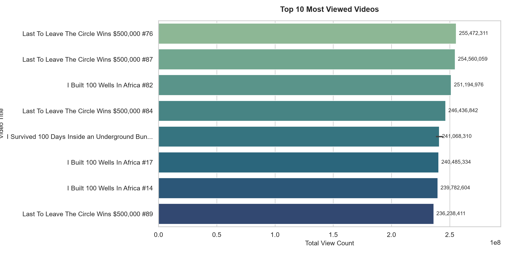
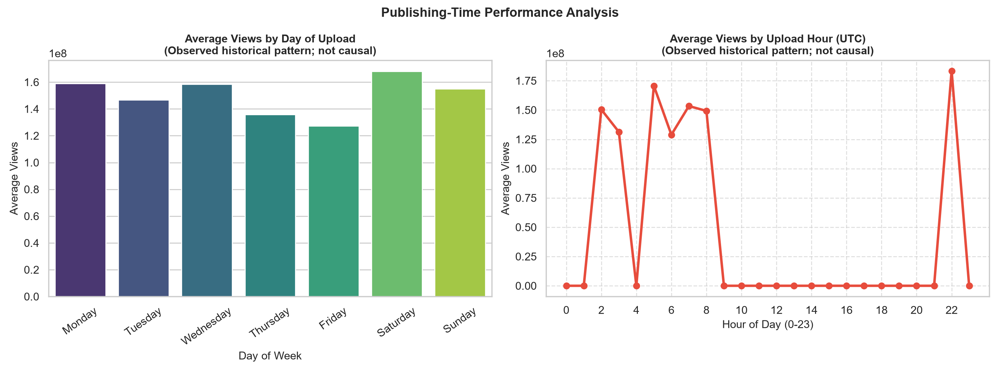
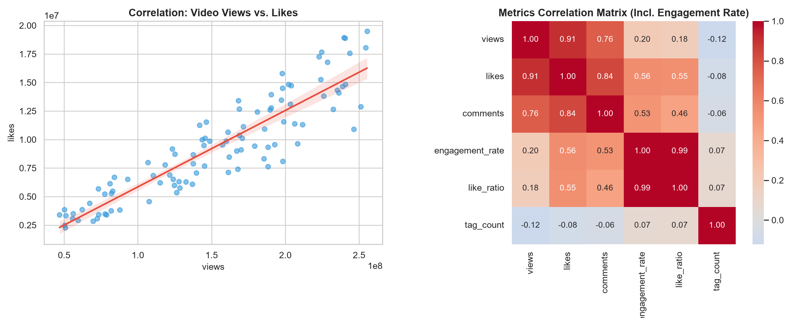
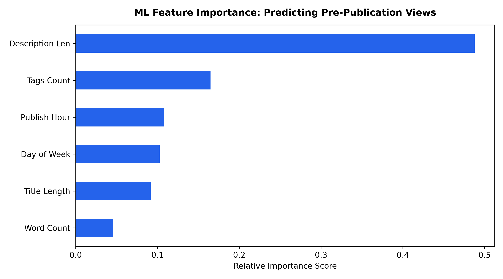
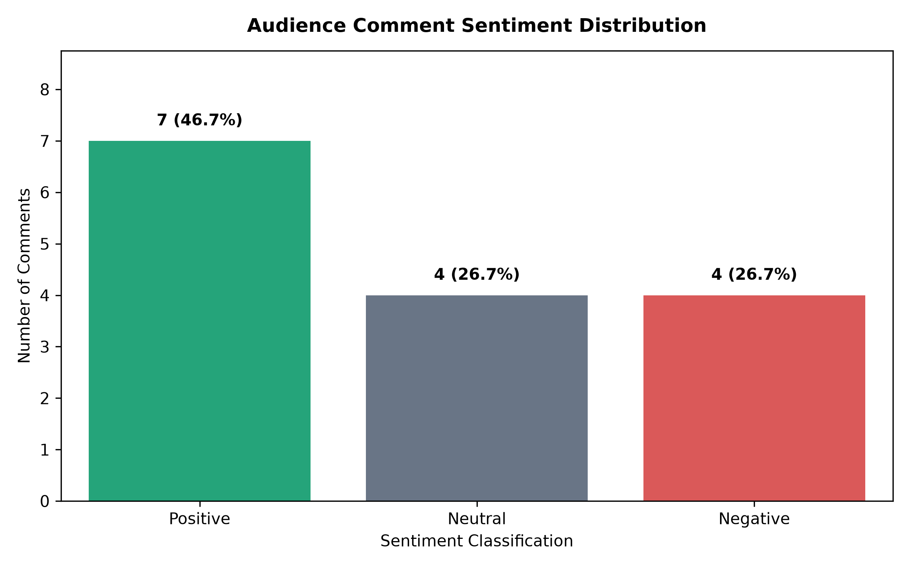
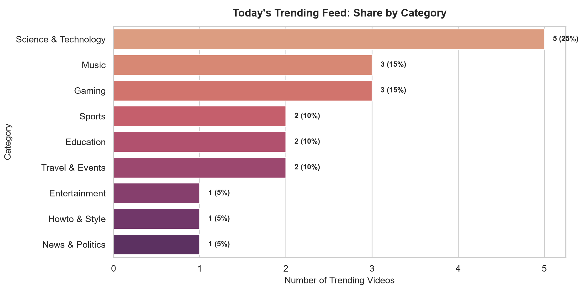
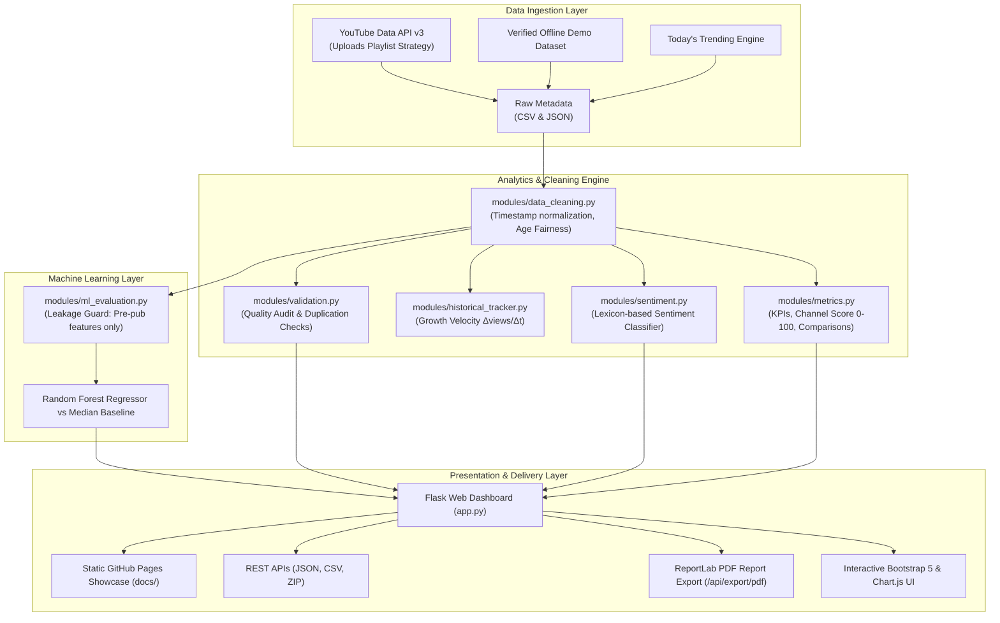

# 🎥 YouTube Creator Intelligence & Analytics Platform

<div align="center">

[](https://www.python.org/)
[](https://flask.palletsprojects.com/)
[](https://scikit-learn.org/)
[](https://github.com/Dhanushree-1977/YOUTUBE-ANALYSIS/actions)
[](LICENSE)
[](Dockerfile)

### *An Interactive Data Analytics and Machine-Learning Platform for Video Performance Analysis, Audience Sentiment, and Data-Driven Content Insights*

[🚀 Live Demo (GitHub Pages)](https://dhanushree-1977.github.io/YOUTUBE-ANALYSIS/) • [📘 Documentation](#-project-architecture) • [🐳 Docker Guide](#-docker-quickstart) • [🧪 Test Suite](#-automated-testing--ci) • [🤝 Contributing](CONTRIBUTING.md)

</div>

---

## 🌟 Executive Overview

The **YouTube Analytics & Trends Platform** is a data science and web platform engineered for content creators, digital media analysts, and researchers. It bridges the gap between raw YouTube API telemetry and actionable editorial decisions through automated data cleaning, age-fair performance metrics, real growth velocity tracking, audience sentiment classification, and a leakage-free Machine Learning view predictor.

The platform provides both a **production Flask web dashboard** (with interactive Chart.js visualizations, comparison tools, and on-the-fly PDF report generation) and a **static GitHub Pages showcase** that runs without requiring a backend server.

---

## 📊 Visual Analytics Gallery

<div align="center">

| Top Viewed Video Benchmarks | Best Publishing Time Patterns |
| :---: | :---: |
|  |  |

| Engagement Rate vs Likes Correlation | ML View Predictor: Feature Importance |
| :---: | :---: |
|  |  |

| Audience Sentiment Distribution | Today's Viral Trends Breakdown |
| :---: | :---: |
|  |  |

</div>

---

## 🏗️ System Architecture



---

## 📊 Component Implementation Status

| Component | Description | Implementation Status | Test Coverage |
| :--- | :--- | :--- | :--- |
| **Data Collection** | Live YouTube Data API v3 Ingestion (Uploads playlist strategy) with automatic fallback to sample demo data | **Implemented & Verified** | Manual & Integration |
| **Channel Performance Score** | Composite multi-factor score out of 100 evaluating reach, engagement, cadence, volume, and sentiment | **Implemented & Verified** | `tests/test_metrics.py` |
| **Video Comparison Tool** | Interactive side-by-side comparison of two videos with winner indicators and Age Fairness (Views/Day) | **Implemented & Verified** | `tests/test_metrics.py` |
| **Historical Growth Tracker** | Timestamped snapshots tracking real view growth velocity ($\Delta \text{views}/\Delta t$) over time | **Implemented & Verified** | `modules/historical_tracker.py` |
| **Smart Content Recommendations** | Evidence-based strategic recommendations for publishing timing, title length, and engagement | **Implemented & Verified** | `tests/test_metrics.py` |
| **Data Cleaning & Age Fairness** | Timestamp parsing, negative coercion, calendar feature derivation, and Views / Day age fairness | **Implemented & Verified** | `tests/test_cleaning.py` |
| **Statistical Metrics & KPIs** | Summary statistics, dynamic ranking, and plain-English automated data explanations | **Implemented & Verified** | `tests/test_metrics.py` |
| **Data Quality Validation** | Comprehensive audit: duplicates, unique video IDs, missing values, date ranges, and quality scores | **Implemented & Verified** | `tests/test_validation.py` |
| **Presentation Benchmark** | Recreates exact 10-video cross-category benchmark and slide charts (Slides 6, 7, 8, 9) from academic PPTX | **Implemented & Verified** | `presentation_benchmark.py` |
| **Publishing-Time Analysis** | Evaluates observed day and hour performance patterns (with explicit correlation vs causation disclaimers) | **Implemented & Verified** | `analyze_data.py` |
| **Machine Learning** | Random Forest Regressor predicting pre-publication views (strictly pre-publication features) vs Median Baseline | **Experimental / Benchmarked** | `tests/test_ml.py` |
| **Sentiment Analysis** | Lexicon-based audience comment classification (Positive, Neutral, Negative) and Comment Explorer | **Experimental / Validated** | `modules/sentiment.py` |
| **Downloadable PDF Report** | Publication-quality multi-page PDF Analytics Report compiled on-the-fly with ReportLab | **Implemented & Verified** | `/api/export/pdf` |
| **Flask Web Dashboard** | Professional 6-section responsive UI styled in dark navy, white cards, blue accents, and emerald highlights | **Implemented & Verified** | Flask Test Client |

---

## 📐 Key Formulas & Standardized Metrics

### 1. YouTube Channel Performance Score (0 to 100)
$$
\text{Channel Score} = 0.30 \times S_{\text{reach}} + 0.30 \times S_{\text{engagement}} + 0.20 \times S_{\text{cadence}} + 0.10 \times S_{\text{volume}} + 0.10 \times S_{\text{sentiment}}
$$
*Each sub-metric is normalized between 0 and 100 before weighted aggregation. Labeled as an illustrative comparative evaluation index.*

### 2. Standardized Engagement Rate
$$
\text{Engagement Rate} = \frac{\text{Likes} + \text{Comments}}{\text{Views}} \times 100
$$
*Example:* A video with 100,000 views, 5,000 likes, and 500 comments yields an engagement rate of **5.50%**. Zero-view edge cases safely return **0.00%**.

### 3. Video Age Fairness (Views per Day)
$$
\text{Views per Day} = \frac{\text{Views}}{\max(1, \text{Video Age in Days})}
$$
*Normalizes viewership by time elapsed since publication, allowing fair comparison between older catalog staples and newly released uploads.*

### 4. Real Growth Velocity (Snapshot Tracking)
$$
\text{Growth Velocity} = \Delta \text{views} = \text{Views}_{t_2} - \text{Views}_{t_1}
$$
*Tracks real growth rate between timestamped snapshot observations instead of relying purely on static lifetime view counts.*

### 5. Machine Learning Pre-Publication Leakage Guard
The Random Forest view predictor strictly limits its inputs to pre-publication features:
* `title_length` (character count)
* `title_word_count` (words)
* `desc_length` (description length)
* `tag_count` (number of tags)
* `day_code` (day of week: Monday=0 ... Sunday=6)
* `hour_code` (upload hour: 0 ... 23 UTC)

Post-publication metrics (such as likes and comments) are **strictly excluded** from model inputs to prevent data leakage. The model is evaluated side-by-side with a naive Median Baseline predictor.

---

## 🖥️ Professional 6-Section Dashboard Layout

1. **Section 1 — Overview & Health:**
   * **Channel Performance Score:** Score out of 100 with rating tier (`Elite`, `Strong`, `Healthy`) and sub-score progress bars.
   * **Data Source Badge:** Indicates **Live API Data**, **Demo Dataset**, or **Uploaded Dataset**.
   * **Timestamp:** Displays `Last updated: 23 October 2026, 9:30 PM` (from data collection).
   * **KPI Stat Cards:** Total Videos Analysed, Total Views, Total Likes, Total Comments, Average Views per Video, and Average Engagement Rate.
   * **Automated Plain-English Insights:** Data-driven statistical summaries comparing top videos against the catalog median.
   * **Smart Content Recommendations:** Evidence-based suggestions for publishing timing, title structure, and engagement replication.

2. **Section 2 — Video Performance & Comparison:**
   * **Interactive Video Comparison Tool:** Pick any two videos and compare views, likes, comments, engagement rate, video age, and views/day with winner badges.
   * **Real Growth Velocity Leaderboard:** Displays $\Delta \text{views}$ and growth % over timestamped snapshots.
   * **Top Video Rankings:** Top 10 Most-Viewed, Most-Liked, Most-Commented, and Highest Engagement Rate with live search filtering.
   * Standardized Engagement Rate formula banner.

3. **Section 3 — Channel Insights & Academic Benchmarks:**
   * **Publishing-Time Performance Analysis:** Day of week and upload hour distributions (with explicit observation caveat).
   * **Upload Consistency Trends:** Yearly volume and monthly upload cadence.
   * **Engagement Trends & Correlation Heatmap:** Views vs. likes with engagement rate correlation.
   * **Academic Presentation Benchmark:** Visualizations reproducing Slides 6, 7, 8, 9 from the PowerPoint deck.
   * **Today's Viral Trends:** Category breakdown share and viral velocity leaderboard.

4. **Section 4 — Audience Sentiment Analysis:**
   * Positive, neutral, and negative comment percentages and counts.
   * Sentiment distribution visual bar chart.
   * **Comment Explorer:** Interactive table displaying raw comments, author, upvote count, sentiment badge, and polarity score, with sentiment filtering.
   * Fallback notice for videos where comments are disabled.

5. **Section 5 — Machine Learning View Predictor:**
   * Interactive calculator form (title, day, hour, tags) computing view estimates.
   * Side-by-side **Model Evaluation Benchmark Table**: Random Forest vs. Median Baseline (MAE, RMSE, $R^2$).
   * Pre-publication feature importance chart and actual vs. predicted view scatter plot.
   * Transparent limitations notice regarding video age, watch-time, and thumbnail CTR.

6. **Section 6 — Reports & Export Studio:**
   * Full Data-Quality Audit table: Total rows & columns, duplicate rows, duplicate video IDs, missing values, date ranges, and categories.
   * **Export Studio:**
     * `Download PDF Analytics Report` &rarr; `/api/export/pdf`
     * `Download Cleaned Dataset (CSV)` &rarr; `/api/export/csv`
     * `Export Analysis Summary (JSON)` &rarr; `/api/export/summary`
     * `Download All 15 Charts (ZIP)` &rarr; `/api/export/charts_zip`

---

## 📁 Project Architecture

```text
YOUTUBE ANALYSIS/
│
├── .github/                         # GitHub Actions CI/CD & Community standards
│   ├── workflows/
│   │   ├── ci.yml                   # Multi-version Python CI (3.10, 3.11, 3.12)
│   │   └── deploy-pages.yml         # Automated GitHub Pages Static Deployment
│   ├── ISSUE_TEMPLATE/              # Bug report & feature request templates
│   │   ├── bug_report.md
│   │   └── feature_request.md
│   ├── dependabot.yml               # Automated dependency bump configuration
│   └── pull_request_template.md     # PR checklist & review guidelines
│
├── docs/                            # GitHub Pages Static Showcase
│   ├── index.html                   # Pre-compiled standalone responsive dashboard
│   ├── favicon.svg                  # Brand favicon
│   ├── .nojekyll                    # Disable Jekyll processing on GitHub Pages
│   └── charts/                      # 15 high-res visualizations for live showcase
│
├── modules/                         # Modular business logic
│   ├── __init__.py                  # Package exports
│   ├── data_cleaning.py             # Timestamp parsing & Age Fairness (Views/Day)
│   ├── metrics.py                   # KPIs, Channel Score, Comparisons & Recommendations
│   ├── validation.py                # Comprehensive data-quality reporting
│   ├── sentiment.py                 # Comment sentiment classification & explorer
│   ├── ml_evaluation.py             # Random Forest training & baseline benchmarking
│   ├── historical_tracker.py        # Timestamped snapshot tracker & growth velocity
│   └── pdf_report.py                # Publication-quality ReportLab PDF generator
│
├── tests/                           # Automated unit test suite (14 tests)
│   ├── __init__.py
│   ├── test_cleaning.py             # Validates cleaning & missing values
│   ├── test_metrics.py              # Validates engagement rate, channel score & comparison
│   ├── test_validation.py           # Validates quality report parameters
│   └── test_ml.py                   # Validates leakage guard & model evaluation
│
├── templates/
│   └── index.html                   # Responsive 6-section Bootstrap 5 UI
│
├── static/                          # Static assets
│   ├── favicon.svg
│   ├── css/.gitkeep
│   └── js/.gitkeep
│
├── output/                          # Verified datasets & visualizations
│   ├── channel_info.json            # Channel metadata & data source tag
│   ├── youtube_videos_raw.csv       # Raw video metadata
│   ├── youtube_videos_cleaned.csv   # Cleaned dataset with engagement metrics
│   ├── today_trending_videos.csv    # Today's trending dataset
│   ├── comments_sample.json         # Classified comment explorer dataset
│   ├── historical_snapshots.json    # Periodic performance observation snapshots
│   ├── presentation_dataset.csv     # 10-video cross-category benchmark
│   ├── rf_model.joblib              # Serialized Random Forest predictor
│   └── charts/                      # 15 generated high-resolution visualizations
│
├── app.py                           # Interactive Flask Web Dashboard (6 Sections)
├── wsgi.py                          # Production WSGI entry point (Gunicorn)
├── run_project.py                   # Master CLI entry point & orchestrator
├── export_static_site.py            # Static showcase generator for GitHub Pages
├── fetch_data.py                    # YouTube Data API v3 collector & paginator
├── analyze_data.py                  # Channel data cleaning & core charts
├── presentation_benchmark.py        # Cross-category academic benchmark (PPTX reproduction)
├── advanced_analysis.py             # ML view predictor & comment sentiment analysis
├── analysis_notebook.ipynb          # 3-part interactive Jupyter notebook
│
├── Dockerfile                       # Production-grade Python 3.12 container
├── docker-compose.yml               # 1-command container orchestration
├── .dockerignore                    # Excludes venv, secrets, and caches
├── render.yaml                      # Render 1-click cloud deployment blueprint
├── Procfile                         # Heroku / Railway / Render web process definition
├── pyproject.toml                   # PEP 621 Python packaging specification
├── requirements.txt                 # Project dependencies
├── .env.example                     # Example template for private API credentials
├── .gitattributes                   # Cross-platform line-ending & binary configs
├── .gitignore                       # Clean Git exclusion rules
├── CONTRIBUTING.md                  # Contribution guidelines
├── CODE_OF_CONDUCT.md               # Contributor Covenant Code of Conduct
├── SECURITY.md                      # Security vulnerability reporting policy
├── LICENSE                          # MIT Open Source License
└── README.md                        # Project documentation
```

---

## 🚀 Quickstart Guide

### Option 1: Local Python Environment

```bash
# 1. Clone the repository
git clone https://github.com/Dhanushree-1977/YOUTUBE-ANALYSIS.git
cd YOUTUBE-ANALYSIS

# 2. Create and activate a virtual environment
# Windows:
python -m venv venv
.\venv\Scripts\Activate.ps1
# Linux / macOS:
python3 -m venv venv
source venv/bin/activate

# 3. Install dependencies
pip install -r requirements.txt

# 4. Run automated test suite
python run_project.py --test

# 5. Launch interactive web dashboard
python run_project.py --web
```
Open **http://127.0.0.1:5000** in your web browser.

---

### Option 2: Docker Quickstart

Run the full platform in an isolated container without installing local Python dependencies:

```bash
# Build and run with Docker Compose
docker compose up --build

# Or build and run with Docker CLI
docker build -t youtube-analytics .
docker run -p 5000:5000 youtube-analytics
```

---

### Option 3: Master CLI Runner Options

The `run_project.py` script provides unified orchestration:

| Command | Action |
| :--- | :--- |
| `python run_project.py --test` | Executes automated unit test suite (`tests/test_*.py`) |
| `python run_project.py --all` | Runs complete 4-step pipeline and generates all 15 charts |
| `python run_project.py --fetch` | Queries YouTube API for live channel & trending data |
| `python run_project.py --analyze` | Cleans data and generates channel & trending charts |
| `python run_project.py --benchmark` | Recreates PPTX cross-category benchmark and slide charts |
| `python run_project.py --ml` | Trains ML model, runs baseline comparison, and sentiment analysis |
| `python run_project.py --web` | Starts interactive web dashboard on port 5000 |

---

## 🌐 Deploy to Cloud Providers

### 1. GitHub Pages (Static Showcase)
The repository automatically deploys a live static preview from `./docs` via GitHub Actions on every push to `main`.
To enable in your fork:
1. Go to **Settings > Pages**.
2. Under **Build and deployment > Source**, select **GitHub Actions** (or **Deploy from a branch > main > /docs**).

### 2. Render (Free Web Service)
1. Fork this repository.
2. Sign in to [Render](https://render.com/).
3. Click **New + > Blueprint** and select your repository.
4. Render will read `render.yaml` and deploy automatically with Gunicorn.

### 3. Railway / Heroku
The included `Procfile` allows 1-click deploys to Railway or Heroku:
```bash
web: gunicorn wsgi:app --bind 0.0.0.0:$PORT
```

---

## 🔌 REST API Reference

| Endpoint | Method | Description | Response Type |
| :--- | :---: | :--- | :---: |
| `/` | `GET` | Main 6-Section Responsive Web Dashboard | `text/html` |
| `/api/predict` | `POST` | Pre-publication ML View Predictor | `application/json` |
| `/api/compare_videos` | `POST` | Side-by-side video comparison with Views/Day | `application/json` |
| `/api/data_quality` | `GET` | Comprehensive data quality audit report | `application/json` |
| `/api/fetch_channel` | `POST` | Live YouTube Data API v3 ingestion | `application/json` |
| `/api/export/pdf` | `GET` | Compiles publication-ready PDF analytics report | `application/pdf` |
| `/api/export/csv` | `GET` | Downloads cleaned YouTube video dataset | `text/csv` |
| `/api/export/summary` | `GET` | Exports complete JSON analytical summary | `application/json` |
| `/api/export/charts_zip` | `GET` | Downloads all 15 high-res PNG charts bundled in a ZIP | `application/zip` |

---

## 🧪 Automated Testing & CI

The platform includes a test suite covering data cleaning, composite scoring, ML leakage prevention, and data quality audits:

```bash
python -m unittest discover tests
```

Output:
```text
..............
----------------------------------------------------------------------
Ran 14 tests in 0.142s

OK
```

Every push and pull request is automatically tested across **Python 3.10, 3.11, and 3.12** on Ubuntu via GitHub Actions ([`.github/workflows/ci.yml`](.github/workflows/ci.yml)).

---

## 📄 License & Maintainer

Distributed under the **MIT License**. See [`LICENSE`](LICENSE) for details.

- **Author & Maintainer:** Dhanushree-1977
- **GitHub:** [@Dhanushree-1977](https://github.com/Dhanushree-1977)
- **Contact:** [dhanushreevm63@gmail.com](mailto:dhanushreevm63@gmail.com)
